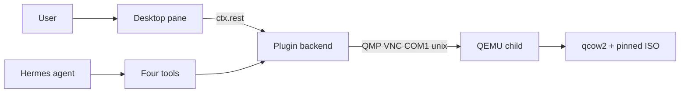

<div align="center">

# TempleOS

**A local TempleOS-family guest in QEMU. The Hermes agent and you share one live screen.**

Default flavor is [TinkerOS](https://github.com/tinkeros/TinkerOS) 5.20-rc10.
Stock [TempleOS](https://templeos.org/) 5.03 and [ZealOS](https://github.com/Zeal-Operating-System/ZealOS) are optional.
Networking is always off. QEMU and ISOs are not bundled.

[](LICENSE)
[](plugin.yaml)
[](plugin.yaml)
[](pyproject.toml)
[](#development)

<!--
Screenshot placeholders (integration fills real paths under docs/images/):
  docs/images/pane-watch.png       — Desktop pane in Watch mode
  docs/images/pane-shared.png      — Shared mode with agent chip
  docs/images/tinkeros-prompt.png  — TinkerOS HolyC prompt (bake-off)
  docs/images/tinkeros-click.png   — Absolute click opened Cmd Line Overview
Do not add  tags until those files exist in this repo.
-->

<sub>
In memory of <strong>Terry A. Davis</strong> (1969–2018), author of TempleOS.
TempleOS is public domain. This plugin is an unofficial Hermes integration and is
not affiliated with Terry's estate, TinkerOS, ZealOS, or Nous Research.
</sub>

[Quickstart](#quickstart) · [Tools](#tools) · [Pane](#desktop-pane) · [Flavors](#flavors) · [Architecture](#architecture) · [Security](#security-and-disclosures) · [Troubleshooting](#troubleshooting) · [Development](#development)

</div>

---

> **Credit and respect.** TempleOS is Terry A. Davis's public-domain operating system —
> a 64-bit hobby OS with a HolyC compiler, 640×480 16-color graphics, and no network stack
> in the original design. Read the [official downloads](https://templeos.org/Downloads/),
> [Credits](https://templeos.info/Wb/Doc/Credits.DD.HTML), and be decent when you demo it.
> [TinkerOS](https://github.com/tinkeros/TinkerOS) and [ZealOS](https://github.com/Zeal-Operating-System/ZealOS)
> are community forks; this plugin defaults to TinkerOS because the bake-off proved absolute
> mouse clicks and Adam `Comm*` serial there.

## What it is

1. **Doctor.** Finds `qemu-system-x86_64`, reports whether `/dev/kvm` can be **opened** (not just whether the node exists), and can fetch the pinned ISO from its official URL with SHA-256 verification.
2. **Start.** Boots TinkerOS (or another flavor) in a child QEMU with `-nic none`, QMP / VNC / COM1 on unix sockets under the plugin data dir, and a writable qcow2 so `savevm` works even on a live CD.
3. **See.** `read_text` prefers COM1 when it is already open; otherwise 8×8 glyphs. `look` returns a PNG (not JPEG) at 640×480 by default (~414 visual tokens).
4. **Act.** Type, send QEMU keys, click / move (VMMouse absolute on TinkerOS), or inject HolyC. After each consequential act: `wait_idle`, then `read_text` or one `look`.
5. **Share.** The Desktop pane shows the same screen. **Take control** / **Hand back** pause the agent with `agent_paused`. Shared mode holds off agent input for ~2 s after you type or click.
6. **Files.** Framed COM1 protocol with a small HolyC helper ([docs/FILES.md](docs/FILES.md)). Host paths stay under the plugin data dir. Never mounts the live RedSea qcow2 while QEMU has it open.

**Skill id:** `templeos:templeos-operator` — load with `skill_view("templeos:templeos-operator")`.

## Quickstart

Plugin id is **`templeos`** (`plugin.yaml` `name`). Hermes requirement is **`>=0.23.0`**.

### System QEMU

```bash
# Debian / Ubuntu
sudo apt install qemu-system-x86 qemu-utils

# Fedora
sudo dnf install qemu-system-x86 qemu-img

# Arch
sudo pacman -S qemu-system-x86 qemu-img

# macOS (TCG only; untested as a primary host)
brew install qemu
```

KVM on Linux needs permission to **open** `/dev/kvm` (group `kvm` is typical). If open fails, the plugin falls back to TCG.

### Install the plugin

```bash
hermes plugins install mojomast/hermes-templeos --enable
hermes plugins doctor templeos
```

Doctor does not install packages. It tells you the apt/brew command, fetches the default TinkerOS ISO from GitHub Releases when missing, verifies the pinned SHA-256, and creates the data-dir layout. There is **no catalog pin yet** — do not treat [docs/catalog/templeos.yaml](docs/catalog/templeos.yaml) as a submitted entry (SHA is a zero placeholder on purpose).

After an update, if the Desktop pane is missing or stale: **Capabilities → Plugins → Rescan**.

### Environment

| Name | Role |
|---|---|
| `TEMPLEOS_HOME` | Plugin data root (ISOs, disks, sockets, frames, exchange). Must not be a filesystem root. Default: Hermes plugin data dir / XDG fallback. |
| `TEMPLEOS_SMOKE` | `1` enables optional live-QEMU smoke tests (needs a pinned ISO already on disk). |

No secrets. No `requires_env`. No dotenv.

## Tools

Four tools, registered from `templeos/tools.py` under toolset `templeos`. Every handler returns a JSON string `{ok, error, code, fix, ...}`.

| Tool | Ops | Role |
|---|---|---|
| `templeos_vm` | `start` `stop` `reset` `snapshot` `restore` `status` `doctor` | Child QEMU lifecycle. `snapshot` ejects non-qcow2 writables first. `restore` issues `cont` if `loadvm` left the VM paused. Sockets are existence flags only, never tokens. |
| `templeos_screen` | `look` `read_text` `wait_idle` `hash` | PNG look, serial/glyph text, cropped idle wait. Full-frame hashes never stabilize (clock / FPS). |
| `templeos_input` | `type` `keys` `click` `move` `holyc` | Keyboard, pointer, HolyC. Returns `agent_paused` when you drive or during the shared hold-off. |
| `templeos_files` | `list` `pull` `push` | Guest paths like `T:/Home/`. Host `src`/`dest` confined under `TEMPLEOS_HOME`. Serial Xfer protocol; FAT push is experimental. |

### Bundled skill

`skills/templeos-operator/SKILL.md` registers as `templeos-operator`. The id inside the file is **`templeos:templeos-operator`**. It teaches `read_text` before `look`, `wait_idle` after input, HolyC idioms, debugger recovery (`G2;` / `Exit;`), snapshot etiquette, hand-back respect, and per-session look/step budgets.

## Desktop pane

The Hermes Desktop pane (`desktop/plugin.js`, needs Hermes `>=0.23.0`) talks only through `ctx.rest` to `/api/plugins/templeos/`. It does not dial `127.0.0.1`, does not read parent tokens, and does not load remote scripts.

| Mode | Behaviour |
|---|---|
| Watch | You see the VM; only the agent injects input. |
| Shared (default) | Both can type. Your key/click pauses the agent ~2 s. |
| Take control | Agent tools return `agent_paused` until **Hand back**. |

Frames are PNG, integer-scaled from 640×480 (ZealOS may present 1024×768). About 10–15 fps is enough. Blob URLs are revoked when the next frame arrives.

<!-- docs/images/pane-watch.png and docs/images/pane-shared.png go here once committed. -->

## Flavors

Bake-off on 9 Nov 2026 (TCG; `/dev/kvm` existed but was not openable on that host). Networking off.

| | **TinkerOS 5.20-rc10** (default) | **TempleOS 5.03** | **ZealOS** (optional) |
|---|---|---|---|
| Boot to desktop | ~14 s | ~14 s | ~16 s (AHCI required) |
| Resolution / tokens | 640×480 / ~414 | 640×480 / ~414 | 1024×768 / ~1036 |
| Absolute QMP click | Pass (VMMouse) | Fail (no abs handler) | Fail |
| Serial text out | `Comm*` → COM1 proven | Raw `OutU8` only | Raw `OutU8`; `Comm*` fragile |
| Screendump avg | ~12 ms | ~12 ms | ~17 ms |
| savevm / loadvm | 1.25 s / 0.20 s | ok (caveats) | ok (caveats) |
| Pick | **Default** | Optional stock | Optional AHCI / dark theme |

ISO pins (SHA-256) live in `templeos/flavors.py`. Official URLs only — not Internet Archive.

## Architecture



Launch shape (proven):

```text
qemu-system-x86_64 -machine pc,kernel-irqchip=off -accel kvm|tcg
  -cpu qemu64 -m 2G -smp 1 -vga std -display none -nic none
  -qmp unix:…/qmp.sock,server=on,wait=off
  -vnc unix:…/vnc.sock
  -serial unix:…/com1.sock,server=on,wait=off
```

TinkerOS / TempleOS: IDE `-cdrom` + qcow2 `if=ide`. ZealOS: AHCI devices (plain IDE reboots). Contracts: [docs/CONTRACTS.md](docs/CONTRACTS.md). File protocol: [docs/FILES.md](docs/FILES.md).

## Security and disclosures

This is what the code is built to do. Catalog reviewers: this is a **child hypervisor**, not an OS sandbox.

- **Child process.** Spawns `qemu-system-x86_64` with an argument array (no shell). Child env is an exact-name allowlist (`templeos.envsafe.child_env`). No dotenv. No `requires_env`. No secret fallback to `os.environ`.
- **ISO fetch.** Doctor may download the pinned flavor ISO from its official URL and refuse a SHA-256 mismatch (partials deleted). QEMU and ISOs are **not** bundled (catalog rule 17).
- **Network.** Guest always `-nic none`. Enabling a fork's networking is not offered.
- **Sockets.** QMP, VNC, and COM1 are unix sockets under the data dir. Never a LAN VNC port. COM1 stays open for the session or guest bytes are lost.
- **Paths.** Host paths resolve symlinks and stay under `TEMPLEOS_HOME` / plugin data. The data root must not be `/`.
- **Files.** Serial Xfer is capped at 256 KiB. Live RedSea qcow2 is never mounted while QEMU holds it. FAT push is experimental.
- **Desktop.** `@hermes/plugin-sdk` / React only. No `eval`, no `new Function`, no prototype patching, no session-token reads. `ctx.rest` only.
- **Payload budget.** Tool/pane JSON including base64 frames must stay under 512 KiB or returns `payload_too_large`.

## Troubleshooting

| What you see | What it means |
|---|---|
| `qemu_missing` | Install `qemu-system-x86_64` and `qemu-img` (see Quickstart). |
| `iso_missing` / `iso_hash_mismatch` | Run `templeos_vm op=doctor`. Delete a bad ISO and re-fetch. |
| KVM reported unusable | `/dev/kvm` exists but cannot be opened. Fix group/udev, or stay on TCG. |
| `serial_not_ready` | Start the VM, keep COM1 open, on TinkerOS run `CommInit;` + `CommInit8n1(1,115200);`, load `Xfer.HC`. |
| ZealOS reboots immediately | Needs AHCI launch flags (flavor `zealos`). Plain IDE is wrong. |
| Debugger screen | `G2;` to continue, `Exit;` to leave, or `templeos_vm op=restore` to `golden`. |
| `agent_paused` | You have Take control, or shared hold-off. Click **Hand back** or wait ~2 s. |
| Pane blank / stale after update | **Capabilities → Plugins → Rescan.** Enable the plugin first. |
| FAT push `experimental` | Expected. Prefer serial Xfer; bake-off did not see FAT12 as `A:`. |
| Apple Silicon / Windows | Untested. TCG may work; not a supported primary host yet. |

## Development

```bash
python3 -m venv .venv
.venv/bin/pip install -e '.[dev]'
.venv/bin/python -m pytest -q tests
export PATH="$HOME/.local/node22/bin:$PATH"   # Node 22 for JS tests
node --import ./tests/js/register-mocks.mjs --test tests/js/*.test.mjs
node scripts/build_desktop.mjs --check
python3 evals/measure_schemas.py
```

`evals/measure_schemas.py` prints one integer: o200k tokens of the four tool schemas. Keep them under about 2,000. Schema delta on this slice must stay **0** (docs/files/skill only from the tools' point of view; do not edit `templeos/tools.py` here).

Live QEMU tests are marked `@pytest.mark.smoke` and skipped unless `TEMPLEOS_SMOKE=1` and a pinned ISO already exists. Do not download ISOs in CI by default.

Parallel slice leases are in [docs/CONTRACTS.md](docs/CONTRACTS.md). This tree's files/docs work lands on `feat/files-docs`.

## License

Code is [MIT](LICENSE), © 2026 Kyle Durepos ([mojomast](https://github.com/mojomast)).

TempleOS is public domain by Terry A. Davis. TinkerOS and ZealOS are their respective authors' projects; ISOs are fetched from official URLs at runtime and are not redistributed in this repository. QEMU is a system package (GPL/LGPL).
