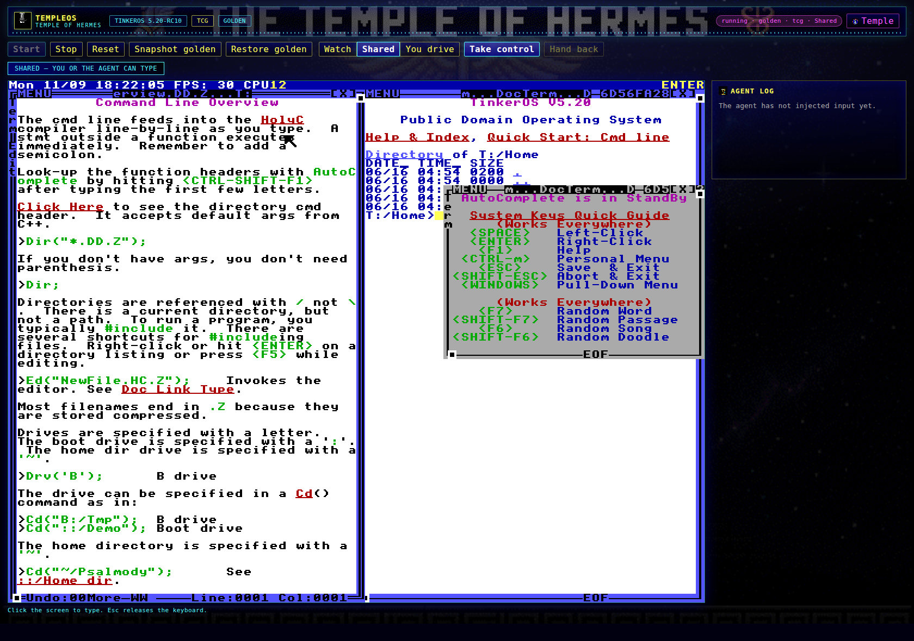
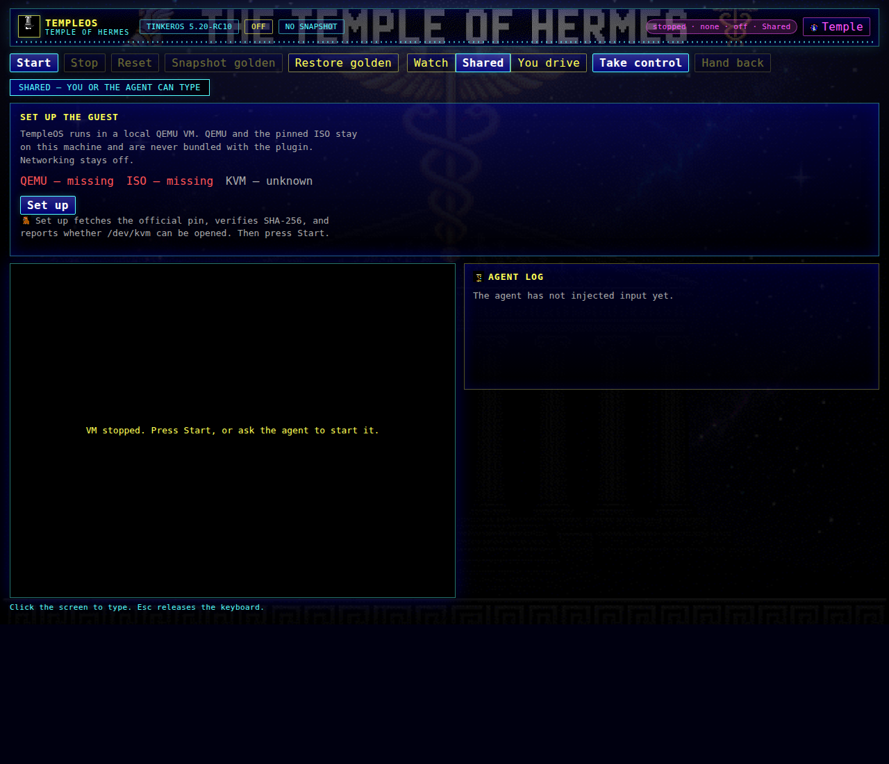

# P2 — Temple of Hermes pane theme

Base: `feat/improvements` at `04bd074` (repo commit `7d1348e`).
All changes are left **uncommitted** and confined to `desktop/`,
`dashboard/` (untouched), `shots/p2-theme/`, and this file.

## What changed

| Path | Change |
| --- | --- |
| `desktop/theme/hermes/` | Copied palette, pane header strip, wallpaper, and 16/32 px icons from the public art branch. `SOURCE.md` records provenance. |
| `desktop/src/ui/theme.js` | Generated asset module: 16-color palette plus PNG data URIs for the header, wallpaper, and icons. |
| `desktop/src/ui/pane.js` | Defaults the pane to the `hermes` theme, sets `data-theme`, exposes an in-memory `Temple` / `VGA` toggle, and uses the temple mark + themed subtitle. |
| `desktop/src/ui/styles.css` | Temple of Hermes theme: gold/cyan/azure/violet palette, pane-header band, temple-night wallpaper, meander rule, icon accents, and focus/glow states. |
| `desktop/shoot_pane.mjs` | Sandbox-portable frame lookup (`tests/fixtures/frames`), `TEMPLEOS_SHOT_DIR` output override, Chrome/Chromium discovery, and theme screenshot cases. |
| `desktop/plugin.js` | Rebuilt from source with `node scripts/build_desktop.mjs`. |
| `shots/p2-theme/` | Nine PNG screenshots (Hermes variants plus a VGA comparison). |

No dashboard route, tool schema, or guest protocol was touched.

## Source art provenance

- Repository: `mojomast/temple-of-hermes`
- Branch: `hermes/art`
- Commit: `97d7ad285ea9942aacf87c50f41927c8c6eae88a` (`97d7ad2`)
- License: public domain (Unlicense)

Copied/adapted files:

| Plugin path | Upstream path |
| --- | --- |
| `desktop/theme/hermes/palette.json` | `art/palette.json` |
| `desktop/theme/hermes/pane-header.png` | `art/ui/pane-header.png` |
| `desktop/theme/hermes/wallpaper-temple-night.png` | `art/wallpaper/toh-temple-night.png` |
| `desktop/theme/hermes/icons/home-temple-32.png` | `art/icons/32/home-temple.png` |
| `desktop/theme/hermes/icons/hermes-chat-32.png` | `art/icons/32/hermes-chat.png` |
| `desktop/theme/hermes/icons/nous-girl-16.png` | `art/icons/16/nous-girl.png` |
| `desktop/theme/hermes/icons/capy-idle-16.png` | `art/icons/16/capy-idle.png` |

`docs/ART.md` in that branch documents the exact `gr32_palette_std` source
(`Adam/Gr/GrPalette.HC`) and confirms the art is symbolic/original pixel art.

## Palette

The full 16-color table is copied verbatim in
`desktop/theme/hermes/palette.json`. The pane accents are:

| Role | Hex |
| --- | --- |
| Ink / background | `#000000` |
| Deep temple blue | `#0000AA` |
| Azure / glow | `#5555FF` |
| Cyan / chrome | `#55FFFF` |
| Gold / primary text | `#FFFF55` |
| Violet / status chip | `#FF55FF` |
| Teal / secondary accent | `#00AAAA` |
| Marble / muted text | `#AAAAAA` |
| Green / OK checks | `#55FF55` |
| Red / failures | `#FF5555` |

Every non-photo color in the theme is one of these palette entries or an
alpha blend of one.

## Theme behavior

- The pane defaults to `data-theme="hermes"`.
- A `Temple` / `VGA` button in the header switches themes for the current
  mount. The choice is in-memory only: no browser storage, no cookie,
  no host request.
- The temple mark uses `home-temple-32.png`; the theme button uses the
  Nous Girl badge; the agent-log heading uses `hermes-chat`; onboarding hints
  use the capybara pose.
- The header strip is the upstream `pane-header.png`; the page background is
  the upstream `toh-temple-night.png` under a dark blue gradient so guest
  frames and logs stay readable.
- Four tools remain: `templeos_vm`, `templeos_screen`, `templeos_input`,
  `templeos_files`. No tool was added or renamed.

## Screenshots

All screenshots are in `shots/p2-theme/`:

| File | Size | State |
| --- | --- | --- |
| `pane-theme-hermes-running.png` | 1680×1180 | Hermes, shared, running |
| `pane-theme-hermes-onboarding.png` | 1280×1100 | Hermes, setup needed |
| `pane-theme-hermes-user-driving.png` | 1680×1180 | Hermes, user driving, focused |
| `pane-theme-hermes-agent-log.png` | 1680×1180 | Hermes, agent busy + log |
| `pane-theme-vga-running.png` | 1680×1180 | VGA comparison |
| `pane-running.png` | 1680×1180 | Default (Hermes) running |
| `pane-onboarding.png` | 1280×1100 | Default (Hermes) onboarding |
| `pane-user-driving.png` | 1680×1180 | Default (Hermes) user driving |
| `pane-agent-log.png` | 1680×1180 | Default (Hermes) agent log |

Generation command:

```bash
TEMPLEOS_SHOT_DIR=shots/p2-theme CHROME=chromium \
  node --import ./tests/js/register-mocks.mjs desktop/shoot_pane.mjs
```

The frame fixtures come from `tests/fixtures/frames/`; no host-only paths or
ISO boot are required for the pane screenshots.





## Verification

| Check | Command | Result |
| --- | --- | --- |
| Desktop bundle is current | `node scripts/build_desktop.mjs --check` | pass |
| Desktop JS tests | `node --import ./tests/js/register-mocks.mjs --test tests/js/*.test.mjs` | 22/22 pass |
| Python suite | `python3 -m pytest -q tests` | 141 passed, 4 skipped |
| Tool schema budget | `python3 evals/measure_schemas.py` | `892` tokens |
| Tool count | `python3 -c "from templeos.tools import tool_specs; print(len(tool_specs()))"` | `4` |
| Secret / host-path scan | scan changed files for loopback hosts, browser storage, user-home paths, workspace paths, user-profile paths, and private-key markers | no matches |

`measure_schemas` was run for reporting only; no schema file was changed.

## Open issues

- The `tests/test_api.py` click stub now accepts `settle_s`/`hold_s`, so the
  former base-code failure is gone on `feat/terry-p2`; see
  `docs/evidence/TERRY-P2.md` for the reconciled full-suite counts.
- The theme embeds PNG data URIs in `desktop/plugin.js` (about 156 KB) so the
  built pane is self-contained inside the Hermes host document. No external
  asset fetch is required.
- QEMU was installed in the sandbox for the Python suite; the theme work
  itself does not boot a guest or download the TinkerOS ISO.
