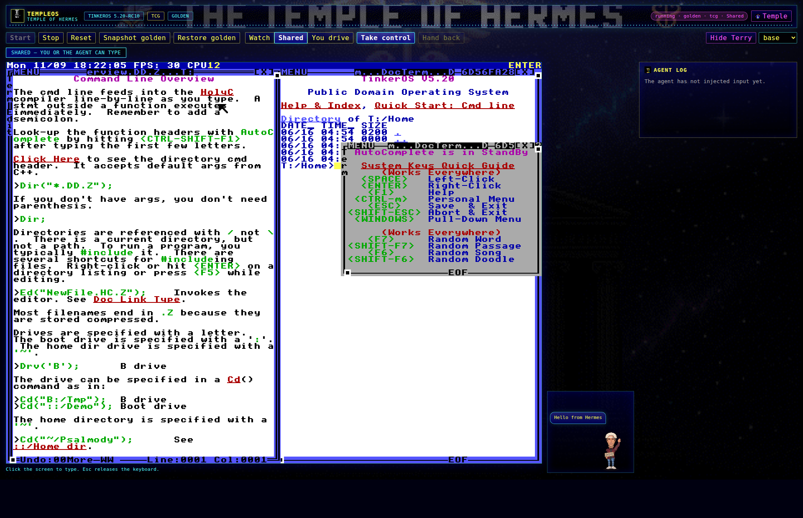

# TERRY-P2 — Terry dock, Hermes theme, and live TCG hooks

## Continuation point

- Resumed from `feat/terry-p2` at `303be768a0b3887757ef49ea9c8c712b4874ea83`
  (WIP collected from `att_6a30609d3472f241`).
- Parent is `feat/terry-companion` at
  `772f18abbdece5c17a57b649535adf4d9beaa811` (PR #3, left untouched).
- The WIP tree already carried the P2 theme (`15b74799cef80d60a5aad8061d2c2203e5589a21`)
  and P4 TCG input fix (`750f55559a90fab415b9471fc7b8c0874e56fb37`). This pass
  finished the pane/style/companion reconcile, the live verification, and the
  evidence; it did not restart from `feat/improvements` or re-merge P2/P4.
- New changes are intentionally left uncommitted so the launcher can collect
  `git diff HEAD` onto `772f18a`.

## Dock layout

`desktop/src/ui/pane.js` renders the guest display and Terry inside one row:

```
.tos-stage-row          display:flex; flex-direction:row; gap:12px; align-items:flex-end
├── .tos-stage          guest screen + keyboard hint
└── .tos-companion-dock Terry sprite + speech bubble lane
```

- `.tos-companion-dock` is `flex: 0 0 var(--tos-companion-width, 200px)` and the
  Hermes theme sets `--tos-companion-width: 208px`.
- `pane.js` reserves `dockPx = 220` and `logPx = 272` before choosing the
  integer guest scale, so Terry and the agent log never force the guest display
  off-screen.
- `.tos-companion-bubble-slot` reserves a 44 px bubble lane above Terry even
  before anyone speaks. `.tos-companion-bubble` uses `max-width: 100%`,
  `overflow-wrap: anywhere`, and `pointer-events: none`; the dock keeps
  `overflow: visible`.
- Below 900 px the stage row wraps and the dock stays aligned to the right edge
  of the guest.

Measured in headless Chromium from the generated pane HTML at 1920 px width
(the `terry-hermes-dark` state, speech `Hello from Hermes`):

| Box | Left | Right | Width | Result |
| --- | --- | --- | --- | --- |
| `.tos-stage` / `.tos-screen` | 14 | 1296 | 1282 | guest display |
| `.tos-companion-dock` | 1308 | 1516 | 208 | to the right of the guest |
| `.tos-companion` (Terry) | 1413 | 1509 | 96 | inside the dock |
| `.tos-companion-bubble` | 1315 | 1449 | 134 | inside the dock, not clipped |

The dock reported `scrollWidth == clientWidth` (206 px) and
`scrollHeight == clientHeight` (194 px), so the bubble neither overflows
horizontally nor pushes the sprite out of the lane.

## Hide and off switches

- The **Hide Terry** button lives in the pane toolbar
  (`data-testid="companion-hide"`) and flips to **Show Terry**. It posts
  `{hidden}` to `/companion` and persists through the plugin data directory.
- `companion: off` in the plugin config is applied at hook-registration time by
  `templeos.companion.apply_config(ctx)`; `TEMPLEOS_COMPANION=off` wins over the
  config value.
- When off, the dock is not rendered, the stage-row widens to the guest, and
  the pane remains fully usable. Hooks stay registered but no-op so a runtime
  switch needs no reload.
- Tests: `tests/js/terry-pane.test.mjs` (hide/off rendering) and
  `tests/test_companion.py::test_config_companion_off_and_hide_toggle`.

## Theme and dark mode

- The pane defaults to `data-theme="hermes"` (P2 Temple of Hermes), with the
  gold/cyan/azure/violet palette, header strip, temple-night wallpaper, and
  embedded icons. A `Temple` / `VGA` button switches themes in memory only.
- The Hermes theme is dark: ink `#000000`, deep blue `#0000AA`, azure
  `#5555FF`, cyan `#55FFFF`, gold `#FFFF55`, plus the rest of the 16-color
  TempleOS palette. All three Terry screenshots are dark-mode captures.
- P2 assets and rules are unchanged apart from the reconciled dock selectors in
  `desktop/src/ui/styles.css`.

## Build

```bash
node scripts/build_desktop.mjs
node scripts/build_desktop.mjs --check
```

Result: `desktop/plugin.js is up to date`. The bundle imports only `react` and
registers the TempleOS pane; it carries the dock, bubble lane, and Hermes dark
theme strings.

## Test results

| Check | Command | Result |
| --- | --- | --- |
| Python suite, no live guest | `python3 -m pytest -q tests` | 141 passed, 4 skipped |
| Python suite, live TCG guest | `TEMPLEOS_SMOKE=1 python3 -m pytest -q tests` | 142 passed, 3 skipped |
| Desktop JS tests | `node --import ./tests/js/register-mocks.mjs --test tests/js/*.test.mjs` | 22 passed, 0 failed |
| Bundle is current | `node scripts/build_desktop.mjs --check` | pass |
| o200k tool schema | `python3 evals/measure_schemas.py` | `892` (delta 0) |
| Tool surface | four existing handlers | `templeos_files`, `templeos_input`, `templeos_screen`, `templeos_vm` |

No fifth tool was added.

## Live QEMU TCG verification

Environment:

- QEMU `8.2.2` (`qemu-system-x86`), accelerator `-accel tcg`
- No `/dev/kvm` in this sandbox (`kvm: false`, `accel: "tcg"`)
- Machine `pc,kernel-irqchip=off`, `-display none`, `-nic none`
- Guest: TinkerOS 5.20-rc10
- ISO SHA-256:
  `feb5cb570a79fefbefeb7d7a7133e3eac0e3b4ffcd6adf8a0fd29049476a1cc4` (verified)

`tests/test_live_tools_smoke.py` now boots the guest under TCG, waits for a real
`T:/Home>` prompt, and drives the same companion hooks Hermes registers through
`plugin.yaml`:

| Hook / request | Assertion | Result |
| --- | --- | --- |
| `on_session_start` | `resolve_animation() == "greet"`, reason `session_start` | pass |
| `pre_tool_call` then live `templeos_screen` `look` | `resolve_animation() == "typing"` while the call is in flight | pass |
| `post_tool_call(ok=True)` for that call | `resolve_animation() == "celebrate_short"`, reason `tool_ok` | pass |
| `POST /companion {"say": "Hello from Hermes"}` | response, `GET /companion`, and `/status` all report `speech.active == true` with text `Hello from Hermes` | pass |

The live run keeps the existing production checks: shifted HolyC one-liner
(`"Hello from Hermes\n"; 6*7;`) typed through `templeos_input`, verified by glyph
OCR as `Hello from Hermes` + `ans=0x0000002A=42`, snapshot/restore, `/frame`
ETag/`since` behavior, shared-mode input pause, and QEMU cleanup. The refreshed
live capture is `shots/p4-tcg-shift/hello-from-hermes.png`.

## Screenshots

All are dark-mode Hermes captures at 1920×1240 in `shots/terry/`:

| File | State |
| --- | --- |
| `terry-hermes-dark.png` | Terry to the right of the guest, speech bubble `Hello from Hermes` fully inside the dock |
| `terry-hermes-typing.png` | `typing` animation, empty reserved bubble lane, agent log populated |
| `terry-hermes-hidden.png` | **Hide Terry** state; dock removed and the guest/log expand |

All three use `data-theme="hermes"` and are dark: pane corners sample near-black
(`rgb(6,6,18)` / `rgb(0,0,16)`) and the dock background is deep temple blue
(`rgb(3,3,75)`), with the bright guest frame as the only large light area.

Generation command:

```bash
TEMPLEOS_SHOT_DIR=shots/terry \
TEMPLEOS_SHOT_ONLY=terry-hermes-dark.png,terry-hermes-typing.png,terry-hermes-hidden.png \
CHROME=chromium node --import ./tests/js/register-mocks.mjs desktop/shoot_pane.mjs
```



## Tribute boundary

This is an original fan tribute. Nothing on screen is presented as a Terry A.
Davis quote: the only bubble text in the evidence is the caller-supplied
`Hello from Hermes` from the brief, and the remaining companion output is
original hook labels/motion names. No canon, quote, or statement is attributed
to him.

## Secret and path scan

The new diff was scanned for API keys/tokens, private-key blocks, loopback or
tailnet addresses, and host-specific home, workspace-directory, or user-profile
paths. No credential or host-path matches were found. The only loopback and
`localStorage` strings left in the diff are negative assertions in
`tests/js/terry-pane.test.mjs` proving the built bundle contains neither. No
secrets, tokens, tailnet addresses, or host paths are printed in this document
or embedded in the screenshots/bundle.

## Open issues

- None for this slice. The P4 TCG shifted-key fix and the P2 theme remain
  intact; `tests/test_api.py` now tolerates the `settle_s`/`hold_s` keywords as
  reconciled in the same change.
